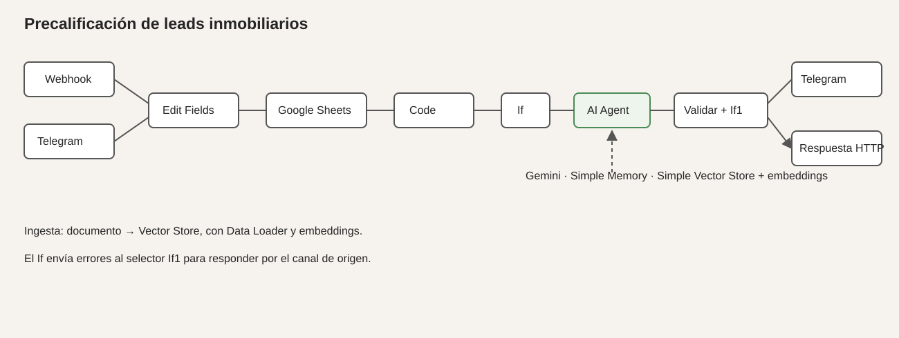

# Proyecto final - n8n y AI Agent

## De que se trata

Este proyecto ordena consultas de personas interesadas en comprar o alquilar una propiedad. La entrada llega por un webhook y el agente devuelve una clasificacion del lead junto con el siguiente paso recomendado para el equipo comercial.

No busca cerrar una operacion automaticamente. La idea es sacar de encima el primer filtro y dejarle a una persona los casos que necesitan criterio comercial.

## ROI estimado

Una consulta puede llevar entre 5 y 8 minutos si alguien tiene que leerla, pedir datos y decidir a quien derivarla. Con unas 40 consultas semanales son cerca de 4 o 5 horas de trabajo repetitivo.

El workflow hace esa primera lectura en segundos. En un volumen chico puede ahorrar unas 3 horas por semana y el ahorro crece si llegan mas consultas. El limite aparece cuando la consulta requiere una negociacion, una visita o una excepcion que no esta en la documentacion. En esos casos se deriva a revision humana.

## Flujo

Webhook -> Edit Fields -> AI Agent -> Respond to Webhook

Como fuente de apoyo queda Google Sheets con datos comerciales. El agente tambien tiene memoria por lead y una Simple Vector Store para recuperar politicas, criterios de atencion y preguntas frecuentes.



## Entradas

- Webhook GET con `lead_id` y `mensaje`
- Google Sheets con datos de propiedades o referencias comerciales
- Contexto documental recuperado desde la Vector Store

## Decision del modelo

Para este prototipo use Gemini en la nube. El volumen esperado es bajo y no tiene sentido mantener un equipo prendido solo para correr Ollama. Ademas permite probar el flujo sin agregar infraestructura local.

La contra es depender de la conexion y del proveedor. Por eso el agente no confirma visitas, no inventa precios y deriva los casos ambiguos.

## Por que un AI Agent

Un nodo de IA simple podria redactar una respuesta, pero aca tiene que elegir una accion entre varias:

- contactar_agente
- enviar_opciones
- pedir_datos
- revision_humana

Ademas puede consultar el contexto del negocio antes de decidir. Por eso tiene mas sentido usar un agente con herramienta de recuperacion y memoria.

## RAG y embeddings

La Vector Store guarda el contenido de la base documental. Gemini Embeddings transforma los textos en vectores y el agente recupera los fragmentos mas relacionados con cada consulta.

Las credenciales y los identificadores reales no se incluyen en este repositorio. Al importar el JSON hay que volver a seleccionar las credenciales de Google y de Gemini en n8n.

## System Prompt

```text
Sos un agente de precalificacion comercial para una inmobiliaria. Analiza la consulta del lead, los datos de propiedades disponibles y el contexto recuperado desde la base documental. Responde en español, de forma clara y breve.

Debes elegir una sola clasificacion: caliente, tibio o frio.
Tambien debes elegir una sola accion: contactar_agente, enviar_opciones, pedir_datos o revision_humana.

Usa solamente los datos recibidos, Google Sheets y el contexto recuperado. No inventes precios, disponibilidad, requisitos ni caracteristicas. Si faltan datos, hay contradicciones o la consulta es ambigua, usa pedir_datos o revision_humana.

No confirmes visitas ni prometas una operacion. Devuelve solo JSON valido con las claves clasificacion, accion, mensaje y confianza. La confianza debe ser un numero entre 0 y 1. No uses markdown ni texto fuera del JSON.
```

## Errores contemplados

1. Si la planilla no devuelve datos, la consulta principal sigue llegando al agente. En una version siguiente agregaria un If para mostrar una alerta cuando la hoja este vacia.
2. Si el mensaje es ambiguo o faltan datos, el prompt obliga a pedir informacion o derivar a una persona.
3. Si Gemini o la Vector Store no responden, el flujo deberia sumar un Error Trigger con una respuesta fija para evitar que el webhook quede esperando.

## Prueba

La respuesta de prueba queda guardada en [capturas/resultado-prueba.json](capturas/resultado-prueba.json).

El workflow exportado esta en [workflow-agente-precalificacion.json](workflow-agente-precalificacion.json).

## Como usarlo

1. Importar el JSON en n8n.
2. Seleccionar las credenciales propias.
3. Revisar el documento y la hoja de Google Sheets.
4. Activar el workflow.
5. Probar el webhook con un `lead_id` y un `mensaje`.

No se suben claves, tokens ni datos reales.
