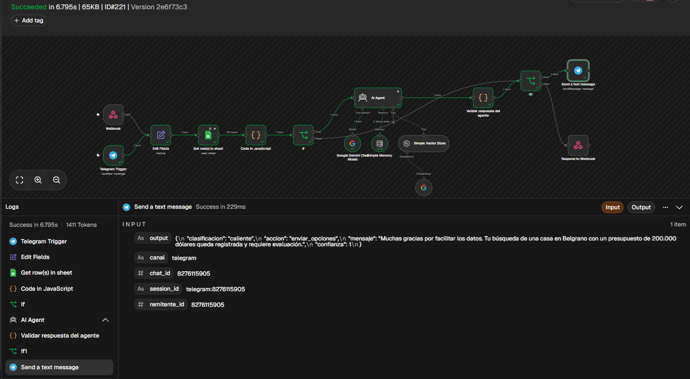
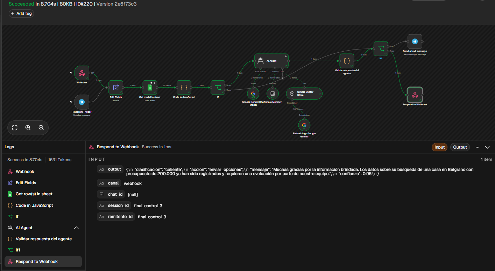

# Proyecto final - n8n y AI Agent

## De que se trata

El flujo recibe una consulta de una persona interesada en una propiedad y hace una primera precalificacion. La idea es ordenar el ingreso de leads, reunir la informacion disponible y dejar una respuesta lista para el equipo comercial.

El proyecto tiene dos entradas: un Webhook para recibir consultas desde un formulario o una integracion HTTP, y un bot de Telegram para que el mismo flujo tambien pueda atender mensajes de una persona. Los dos caminos terminan usando la misma logica de validacion, el agente y la respuesta correspondiente.

No intenta cerrar una operacion ni confirmar una visita. Cuando la consulta no alcanza o aparece un error, queda marcada para pedir datos o revisar con una persona.

## ROI estimado

Leer una consulta, revisar la informacion disponible y decidir como seguir lleva aproximadamente entre 5 y 8 minutos. Con unas 40 consultas por semana son alrededor de 4 horas de trabajo repetido.

Si se estiman 8 horas iniciales de armado y pruebas, y 3 horas ahorradas por semana, la inversión de tiempo se recuperaría en unas 2,7 semanas. Son estimaciones, no tiempos medidos. El ahorro neto después de cuatro semanas sería de unas 4 horas, sin contar mantenimiento ni costos del proveedor.

El workflow hace ese primer filtro en segundos. En un volumen normal puede ahorrar unas 3 horas semanales y, si llegan mas consultas, mantiene el mismo criterio sin sumar otra tarea manual. Los casos comerciales especiales siguen necesitando revision humana. Con menos de unas 4 consultas semanales el ahorro sería menor a unos 18 minutos por semana, y el mantenimiento puede superar el beneficio.

## Como queda armado

El flujo principal tiene dos entradas:

- Webhook -> Edit Fields -> Google Sheets -> Code in JavaScript -> If
- Telegram Trigger -> Edit Fields -> Google Sheets -> Code in JavaScript -> If

Despues del If, los datos validos pasan por el AI Agent. El agente usa Gemini, memoria simple por lead y una Simple Vector Store con embeddings de Gemini. La salida pasa por el nodo `Validar respuesta del agente`, que revisa el JSON antes de devolverlo.

Desde `If1` se separa el canal de salida:

- si la entrada fue por Telegram, se usa `Send a text message`
- si la entrada fue por Webhook, se usa `Respond to Webhook`

Google Sheets aporta una fuente adicional de datos. El nodo Code revisa si llegaron filas, conserva el mensaje original, identifica el lead y calcula si aparecen el tipo de propiedad, la zona y el presupuesto. Esa comprobación es aproximada: un número no necesariamente es un presupuesto. Las filas completas no se envían al prompt del agente.


## Entrada y salida

El Webhook recibe por GET los campos `lead_id` y `mensaje`.

Ejemplo de prueba:

`/webhook-test/precalificacion-leads?lead_id=validacion-001&mensaje=Busco%20un%20departamento%20de%202%20ambientes%20en%20Caballito%20con%20presupuesto%20de%20150000%20USD`

Telegram recibe el texto del mensaje desde `message.text` y usa `message.chat.id` como identificador de sesion y como destino de la respuesta.

La salida del agente es un JSON con:

- `clasificacion`: caliente, tibio, frio o revision_humana
- `accion`: contactar_agente, enviar_opciones, pedir_datos o revision_humana
- `mensaje`: texto breve para continuar la conversacion
- `confianza`: valor entre 0 y 1

Para Telegram se envia el campo `mensaje`. Para el Webhook se devuelve el JSON completo.

## Eleccion del modelo

Para este prototipo se eligio Gemini en la nube. Para el volumen de prueba, la nube evita instalar y mantener una máquina con Ollama. El costo depende de los límites vigentes del servicio y del uso real; no se comparó con una medición de hardware local. Tambien simplifica la conexion con embeddings y el uso de n8n Cloud.

La contra es que el mensaje sale hacia un proveedor externo y que la respuesta depende de internet. El mensaje y un identificador se envían al modelo, por lo que deben tratarse como datos potencialmente personales. El prompt no incluye las filas completas de Sheets. Si el volumen sube mucho conviene evaluar un modelo local o una arquitectura hibrida.

## Por que un AI Agent

Una cadena simple podria redactar un texto, pero en este caso el nodo tiene que consultar contexto, usar la memoria del lead y elegir entre varias acciones posibles. Por eso se usa un AI Agent conectado al modelo de Gemini, la memoria y la herramienta de recuperacion.

## RAG y memoria

La Simple Vector Store se usa como herramienta del agente. Los embeddings de Gemini permiten buscar los fragmentos relacionados con la consulta. El documento de ingesta describe la política comercial: no inventar precios ni disponibilidad, no confirmar visitas y derivar casos ambiguos. La recuperación depende de que la base esté cargada en la misma instancia.

La carga documental esta separada en [workflow-ingesta-rag.json](workflow-ingesta-rag.json). Ese workflow tiene este recorrido:

`Manual Trigger -> Documento base -> Simple Vector Store - Ingesta`, con Default Data Loader y embeddings conectados a la Vector Store.

El Data Loader y los embeddings de Gemini se conectan a la Vector Store. La memoria simple usa `lead_id` en el Webhook y `message.chat.id` en Telegram.

## System Prompt

```text
Sos un agente de precalificación para una inmobiliaria. Respondé en español, breve y claro. Usá la memoria de esta conversación para conservar tipo de propiedad, zona y presupuesto ya indicados. La validación datos_completos solo analiza el mensaje actual, no el historial; no repitas preguntas si el dato aparece en memoria. Si preguntan qué dato mencionaron, respondé según el historial. Consultá la herramienta documental para políticas. Si no devuelve información suficiente para una pregunta documental, indicá que no está disponible y recomendá revisión humana; no inventes ni pidas datos como condición para responder. Si hay ambigüedad o la consulta excede tu alcance, indicá que requiere revisión humana sin afirmar que alguien fue avisado o que ya se derivó. Podés clasificar como frio, tibio, caliente o revision_humana y elegir pedir_datos, enviar_opciones, contactar_agente o revision_humana. La acción es una recomendación interna: no afirmes que se preparan o enviarán opciones, que alguien fue contactado o que se confirmó una visita. No inventes disponibilidad, precios, moneda ni plazos. Si los datos están completos, agradecé e indicá que requiere evaluación. Devolvé solo JSON válido con clasificacion, accion, mensaje y confianza entre 0 y 1.
```

## Controles y errores

Google Sheets tiene reintentos y el nodo Code revisa si llegaron filas y si alguna contiene un error. El primer If valida el mensaje y el estado de la hoja antes de dejar pasar la consulta al agente.

La respuesta del agente pasa por un nodo que valida los campos del JSON y revisa algunas frases de promesas no verificadas. Si detecta un problema devuelve `revision_humana`. El filtro es una protección básica y no garantiza detectar todas las formas de prometer una acción.

Si falta el mensaje o falla la lectura de Sheets, el flujo construye una respuesta de control y `If1` la envía por el canal de origen. Si el agente falla, la ejecución continúa hacia el validador, que devuelve revisión humana.





## Archivos

- [workflow-agente-precalificacion.json](workflow-agente-precalificacion.json)
- [workflow-ingesta-rag.json](workflow-ingesta-rag.json)
- [resultado de prueba en JSON](capturas/resultado-prueba.json)
- [diagrama del flujo](capturas/arquitectura.svg)

El workflow se comparte sin credenciales ni referencias a una hoja de cálculo. Al importarlo, hay que seleccionar las credenciales propias de Google Sheets, Gemini y Telegram y configurar el documento y la hoja en el nodo de Google Sheets.

## Como probarlo

1. Importar el workflow principal en n8n.
2. Seleccionar las credenciales de Google Sheets, Gemini y Telegram.
3. Revisar el documento y el nombre de la hoja.
4. Importar y ejecutar la ingesta RAG; verificar que inserte el documento con la clave indicada y que el agente lo recupere.
5. Probar el Webhook con `lead_id` y `mensaje`.
6. Enviar un mensaje al bot de Telegram y revisar la ejecucion.
7. Verificar que la respuesta salga por el mismo canal de entrada.
