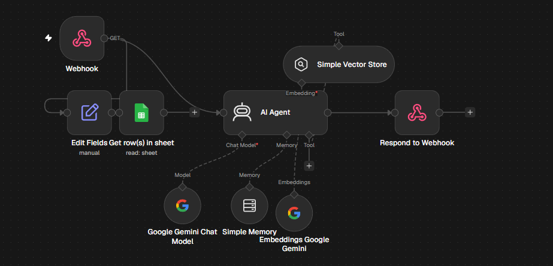
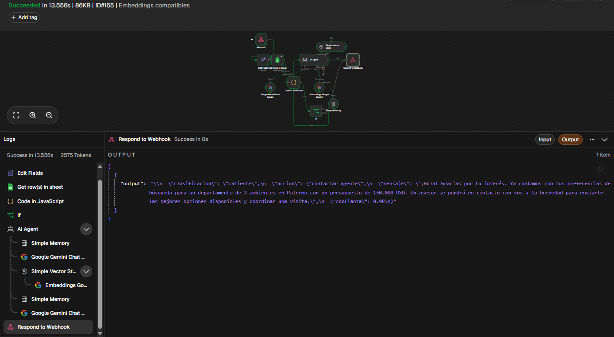

# Proyecto final - n8n y AI Agent

## De que se trata

El flujo recibe una consulta de una persona interesada en una propiedad y hace una primera precalificacion. La idea es ordenar el ingreso de leads, reunir la informacion disponible y dejar una respuesta lista para el equipo comercial.

El proyecto tiene dos entradas: un Webhook para recibir consultas desde un formulario o una integracion HTTP, y un bot de Telegram para que el mismo flujo tambien pueda atender mensajes de una persona. Los dos caminos terminan usando la misma logica de validacion, el agente y la respuesta correspondiente.

No intenta cerrar una operacion ni confirmar una visita. Cuando la consulta no alcanza o aparece un error, queda marcada para pedir datos o revisar con una persona.

## ROI estimado

Leer una consulta, revisar la informacion disponible y decidir como seguir lleva aproximadamente entre 5 y 8 minutos. Con unas 40 consultas por semana son alrededor de 4 horas de trabajo repetido.

El workflow hace ese primer filtro en segundos. En un volumen normal puede ahorrar unas 3 horas semanales y, si llegan mas consultas, mantiene el mismo criterio sin sumar otra tarea manual. Los casos comerciales especiales siguen necesitando revision humana.

## Como queda armado

El flujo principal tiene dos entradas:

- Webhook -> Edit Fields -> Google Sheets -> Code in JavaScript -> If
- Telegram Trigger -> Edit Fields -> Google Sheets -> Code in JavaScript -> If

Despues del If, los datos validos pasan por el AI Agent. El agente usa Gemini, memoria simple por lead y una Simple Vector Store con embeddings de Gemini. La salida pasa por el nodo `Validar respuesta del agente`, que revisa el JSON antes de devolverlo.

Desde `If1` se separa el canal de salida:

- si la entrada fue por Telegram, se usa `Send a text message`
- si la entrada fue por Webhook, se usa `Respond to Webhook`

Google Sheets aporta una segunda fuente con datos comerciales. El nodo Code ordena las filas, conserva el mensaje original, identifica el lead y calcula si ya estan presentes el tipo de propiedad, la zona y el presupuesto.



## Entrada y salida

El Webhook recibe por GET los campos `lead_id` y `mensaje`.

Ejemplo de prueba:

`/webhook-test/precalificacion-leads?lead_id=validacion-001&mensaje=Busco%20un%20departamento%20de%202%20ambientes%20en%20Caballito%20con%20presupuesto%20de%20150000%20USD`

Telegram recibe el texto del mensaje desde `message.text` y usa `message.chat.id` como identificador de sesion y como destino de la respuesta.

La salida del agente es un JSON con:

- `clasificacion`: caliente, tibio, frio o revision_humana
- `accion`: contactar_agente, enviar_opciones, pedir_datos o revision_humana
- `mensaje`: texto breve para continuar la conversacion
- `confianza`: valor entre 0 y 1

Para Telegram se envia el campo `mensaje`. Para el Webhook se devuelve el JSON completo.

## Eleccion del modelo

Para este prototipo se eligio Gemini en la nube. El volumen esperado es bajo y el costo por consulta es menor que mantener una maquina con Ollama encendida. Tambien simplifica la conexion con embeddings y el uso de n8n Cloud.

La contra es que el mensaje sale hacia un proveedor externo y que la respuesta depende de internet. Por eso el flujo no envia datos personales innecesarios, usa un identificador de lead y agrega controles antes de responder. Si el volumen sube mucho conviene evaluar un modelo local o una arquitectura hibrida.

## Por que un AI Agent

Una cadena simple podria redactar un texto, pero en este caso el nodo tiene que consultar contexto, usar la memoria del lead y elegir entre varias acciones posibles. Por eso se usa un AI Agent conectado al modelo de Gemini, la memoria y la herramienta de recuperacion.

## RAG y memoria

La Simple Vector Store se usa como herramienta del agente. Los embeddings de Gemini permiten buscar los fragmentos relacionados con la consulta. La base contiene la politica comercial del proyecto: no inventar precios ni disponibilidad, no confirmar visitas y derivar los casos ambiguos.

La carga documental esta separada en [workflow-ingesta-rag.json](workflow-ingesta-rag.json). Ese workflow tiene este recorrido:

`Manual Trigger -> Documento base -> Default Data Loader -> Simple Vector Store - Ingesta`

El `Recursive Character Text Splitter` entra como subnodo del Data Loader y los embeddings de Gemini se conectan a la Vector Store. Primero se ejecuta la ingesta y despues se prueba el workflow principal.

La memoria simple usa `lead_id` en el Webhook y `message.chat.id` en Telegram. De esta forma las conversaciones no se mezclan entre leads.

## System Prompt

```text
Sos un agente de precalificacion comercial para una inmobiliaria. La entrada incluye datos calculados por nodos anteriores.

Regla prioritaria: si datos_completos=true, consideralo una validacion confiable. En ese caso esta prohibido clasificar como frio, usar pedir_datos o volver a preguntar tipo de propiedad, zona o presupuesto. Debes clasificar como tibio y usar enviar_opciones, o como caliente y usar contactar_agente.

Si datos_completos=false, usa pedir_datos solo por los datos que falten. Analiza tambien Google Sheets y el contexto RAG, pero no contradigas la validacion previa salvo que encuentres una contradiccion clara. Si la base documental no tiene coincidencias, continua con los datos disponibles.

No inventes precios, disponibilidad, requisitos ni caracteristicas. No confirmes visitas ni prometas operaciones. Responde en español, claro y breve.

Devuelve solo JSON valido, sin markdown, con clasificacion, accion, mensaje y confianza. La confianza debe ser un numero entre 0 y 1.
```

## Controles y errores

Google Sheets tiene reintentos y el nodo Code revisa si llegaron filas y si alguna contiene un error. El primer If valida el mensaje y el estado de la hoja antes de dejar pasar la consulta al agente.

La respuesta del agente pasa por un nodo de validacion que revisa los campos del JSON y reemplaza clasificaciones invalidas o mensajes que prometan una visita por `revision_humana`. Esto evita que una salida del modelo termine confirmando una visita o una disponibilidad que no fueron verificadas.

Si Telegram no entrega un mensaje valido, el flujo no intenta responder con un chat inexistente. Si falla el envio, el error queda visible en la ejecucion de n8n para su revision.



## Archivos

- [workflow-agente-precalificacion.json](workflow-agente-precalificacion.json)
- [workflow-ingesta-rag.json](workflow-ingesta-rag.json)
- [resultado de prueba en JSON](capturas/resultado-prueba.json)
- [diagrama del flujo](capturas/arquitectura.svg)

Las credenciales, tokens y datos personales no se incluyen en el repositorio. Al importar los workflows hay que seleccionar las credenciales propias de Google Sheets, Gemini y Telegram.

## Como probarlo

1. Importar el workflow principal en n8n.
2. Seleccionar las credenciales de Google Sheets, Gemini y Telegram.
3. Revisar el documento y el nombre de la hoja.
4. Ejecutar la ingesta RAG una vez.
5. Probar el Webhook con `lead_id` y `mensaje`.
6. Enviar un mensaje al bot de Telegram y revisar la ejecucion.
7. Verificar que la respuesta salga por el mismo canal de entrada.

## Evidencias pendientes de actualizar

Las capturas que estan en la carpeta `capturas` corresponden a la version anterior del flujo. Para dejar el repositorio alineado con la version actual faltan:

- una captura del canvas completo donde se vean el Webhook y el Telegram Trigger
- una captura de una ejecucion real iniciada desde Telegram donde se vea el mensaje recibido y la respuesta
- una captura del nodo `Send a text message` con la salida correcta
- si es posible, una captura del workflow de ingesta RAG ejecutado correctamente

No se deben mostrar tokens, credenciales, correos, telefonos ni datos reales de leads en las capturas.
